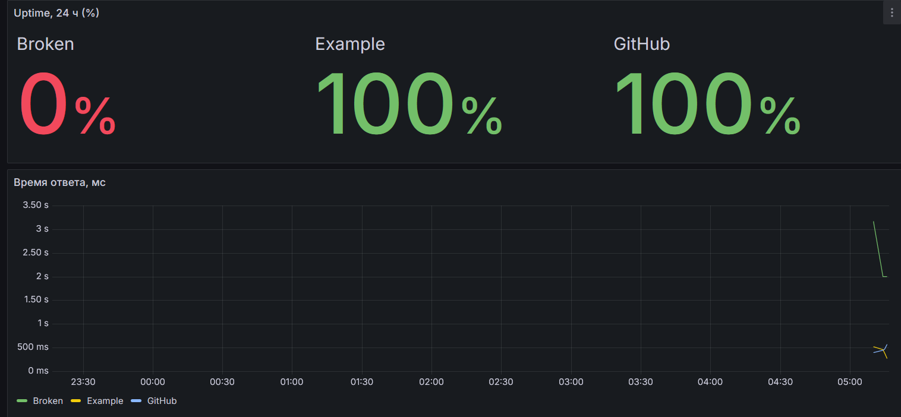

# Uptime Monitor


Python-сервис, который периодически проверяет доступность сайтов, сохраняет историю в PostgreSQL и показывает её в Grafana.



## Возможности

- HTTP-проверки списка URL из `config.yaml` (код ответа, время ответа, текст ошибки)
- История проверок в PostgreSQL, SQL-схема в `sql/`
- Готовый дашборд Grafana (uptime, latency, последние сбои), подключается автоматически
- Тесты на Pytest, линтер ruff, CI в GitHub Actions
- Запуск одной командой через Docker Compose

## Архитектура

```
config.yaml ──► app (checker) ──► PostgreSQL ──► Grafana :3000
```

## Быстрый старт

```bash
cp .env.example .env      # задайте пароли
docker compose up -d --build
```

Grafana: http://localhost:3000 (логин `admin`, пароль из `GRAFANA_ADMIN_PASSWORD`),
дашборд **Uptime Monitor** в папке *Uptime Monitor*.

## Конфигурация

`config.yaml`:

```yaml
interval_seconds: 30
timeout_seconds: 5
targets:
  - name: GitHub
    url: https://github.com
```

## Тесты

```bash
python -m venv .venv && source .venv/bin/activate
pip install -r requirements-dev.txt

# тесты без БД
pytest

# вместе с тестами хранилища (нужен Postgres)
docker compose up -d db
docker compose exec db createdb -U uptime uptime_test
TEST_DATABASE_URL=postgresql://uptime:<пароль>@localhost:5432/uptime_test pytest -v
```

## Структура

| Путь | Назначение |
|------|-----------|
| `app/` | код сервиса (checker, storage, config, main) |
| `sql/` | схема БД и запросы для Grafana |
| `tests/` | Pytest-тесты |
| `grafana/` | provisioning и JSON дашборда |
| `.github/workflows/` | CI |